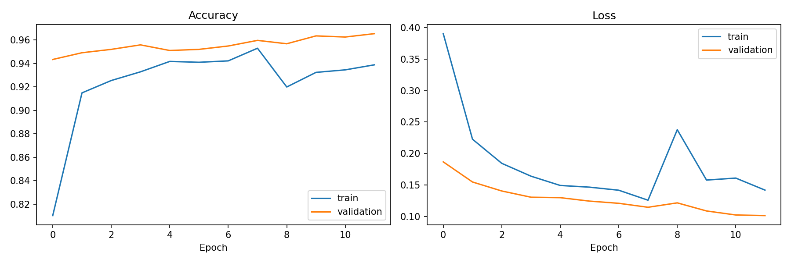
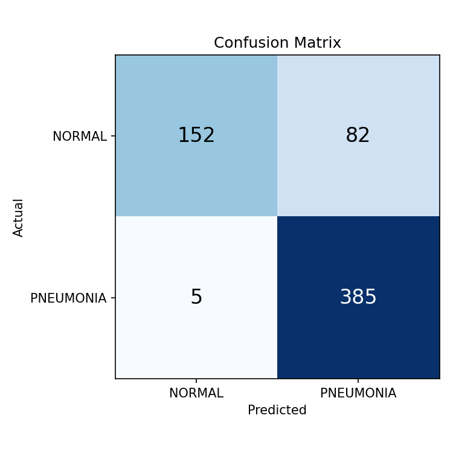
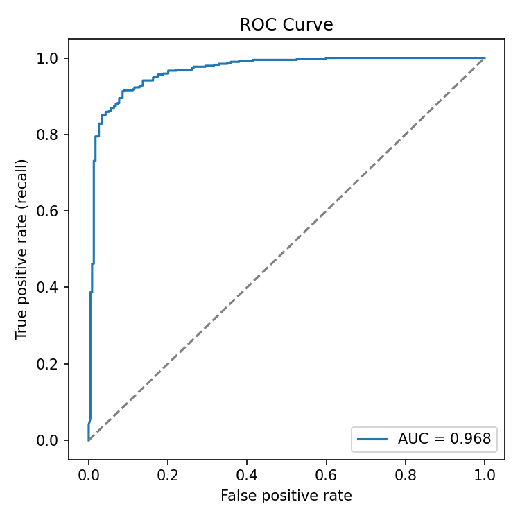
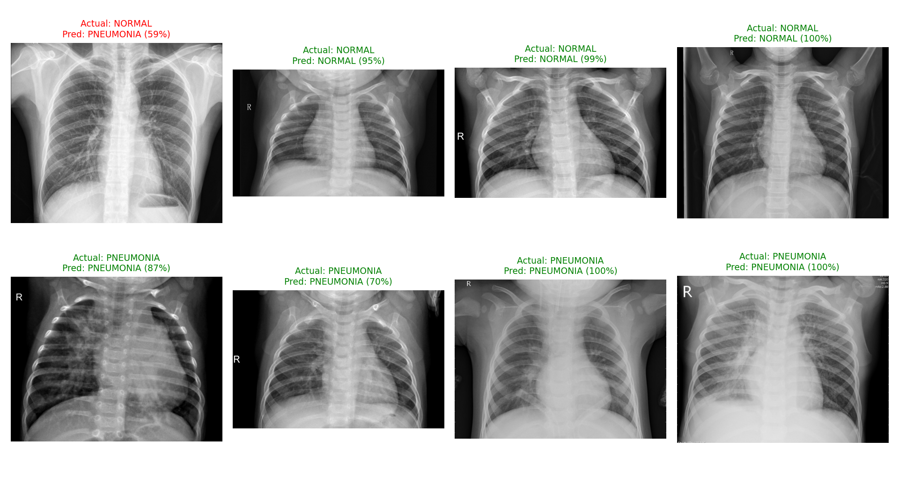
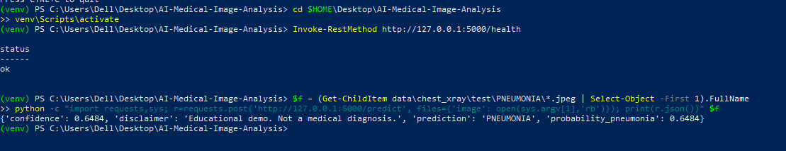

# 🩻 AI-Powered Medical Image Analysis

Pneumonia detection from chest X-rays using transfer learning (MobileNetV2), built on a public dataset and simulating an AI "second reader" for radiologists.

> ⚠️ **Disclaimer:** Educational project only. Not a medical device and not for clinical use.

## Overview
A deep-learning pipeline that classifies chest X-rays as **NORMAL** or **PNEUMONIA**. It covers data exploration, preprocessing, a baseline CNN, a MobileNetV2 transfer-learning model, evaluation, and visual prediction review.

## Problem Statement
Radiologists face growing scan volumes and fatigue. Automated screening can help prioritise urgent cases and reduce missed findings.

## Tech Stack
Python · TensorFlow/Keras · OpenCV · NumPy · scikit-learn · Matplotlib · Google Colab (T4 GPU for training)

## Dataset
[Chest X-Ray Images (Pneumonia)](https://www.kaggle.com/datasets/paultimothymooney/chest-xray-pneumonia): about 5,800 pediatric X-rays. Not included in this repo. The official `val` folder has only 16 images, so 20% of the training set is used for validation.

## Approach
1. Resize to 224×224 RGB, scale to [-1, 1]
2. Augmentation (small rotation, zoom, contrast; no horizontal flip, since it would put the heart on the wrong side)
3. Baseline: small 3-block CNN
4. Main model: MobileNetV2 (ImageNet weights), trained in two stages (head first, then fine-tuning the top 30 layers at a low learning rate)
5. Class weights to handle the ~3:1 pneumonia-to-normal imbalance

## Results (held-out test set, 624 images)

| Model | Accuracy | Pneumonia recall | Pneumonia precision | NORMAL recall | ROC-AUC |
|---|---|---|---|---|---|
| Baseline CNN | 0.761 | 0.990 | 0.727 | 0.380 | 0.934 |
| MobileNetV2 | **0.861** | 0.987 | 0.824 | **0.650** | **0.968** |

MobileNetV2 keeps pneumonia recall near 0.99 (very few missed cases) while cutting false alarms substantially compared with the baseline, which tended to predict "pneumonia" for most images.






## Limitations
- NORMAL recall is 0.65, so about a third of healthy X-rays are flagged as pneumonia.
- Pediatric, single-source data; no external validation.
- The Kaggle test set has a different distribution from the training set, so results may not generalise.
- A single training run, with no cross-validation or confidence intervals.
- No explainability yet (e.g. Grad-CAM).

## Future Work
Grad-CAM heatmaps · decision-threshold tuning on the validation set · external dataset testing · multi-disease classification · Flask/Streamlit demo.

## Installation
```bash
git clone https://github.com/yaswitha-kamakshi/AI-Medical-Image-Analysis.git
cd AI-Medical-Image-Analysis
python -m venv venv
venv\Scripts\activate        # Mac/Linux: source venv/bin/activate
pip install -r requirements.txt
```
Download the dataset into `data/chest_xray/`.

## Usage
```bash
python main.py explore
python main.py train          # GPU (e.g. Colab) recommended
python main.py evaluate
python main.py grid
python main.py predict --image path/to/xray.jpeg
```
## API demo
```bash
python app.py
# in another terminal: POST an image to http://127.0.0.1:5000/predict (form key: "image")
```
Returns JSON with `prediction`, `probability_pneumonia` and `confidence`.



## Learning Outcomes
Transfer learning · handling class imbalance · medical metrics (recall, AUC) · modular ML code · reproducible Git workflow.

## License
MIT